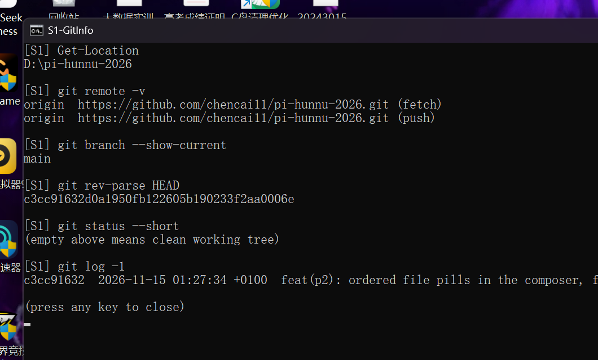
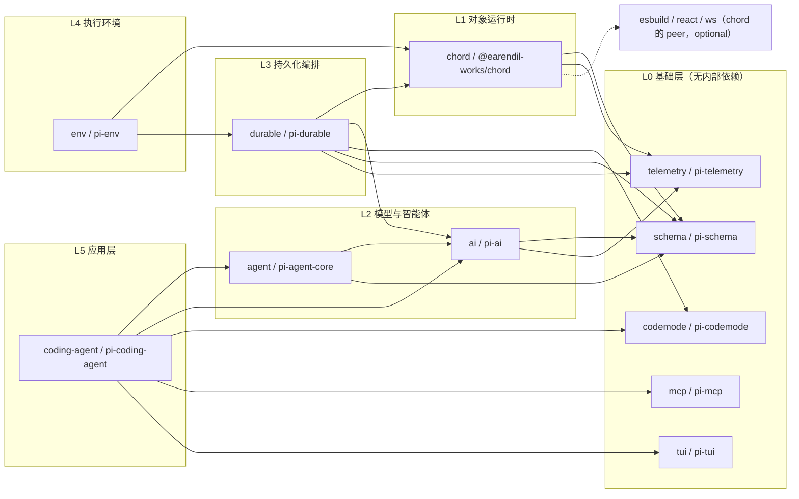
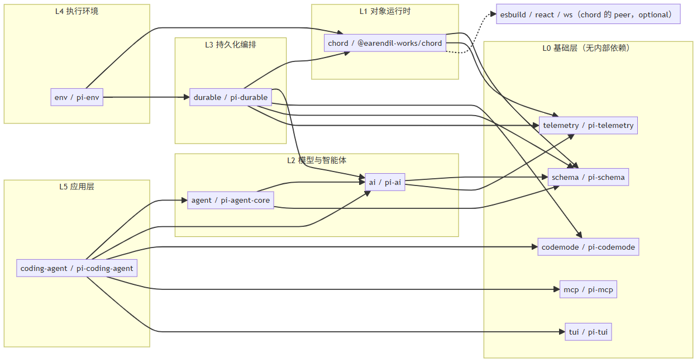

# 实践课 2：组织建仓与源码分析

> 小组代码仓库：<https://github.com/chencai11/pi-hunnu-2026>
> 分析对象：`chencai11/pi-hunnu-2026` 仓库 `main` 分支，提交 `c3cc91632d0a1950fb122605b190233f2aa0006e`
> （分析使用的文件路径均相对于仓库根目录，可逐一核对）

---

## 一、源码获取（对应截图 S1）

### 1.1 实际执行的命令

```bash
# 本机直连 GitHub 会被重置（curl https://github.com 返回 000），
# 需要先开本地代理（Clash Verge，混合端口 7897），再执行：
git clone --branch main https://github.com/chencai11/pi-hunnu-2026.git
cd pi-hunnu-2026
```

> 备注：本机的 git 默认走 Windows schannel，若报
> `schannel: AcquireCredentialsHandle failed: SEC_E_NO_CREDENTIALS`，
> 加 `-c http.sslBackend=openssl` 即可（本次就是这样克隆成功的）。

### 1.2 版本确认结果

| 检查项 | 结果 |
| --- | --- |
| 当前目录 | `D:\pi-hunnu-2026` |
| `git remote -v` | `origin  https://github.com/chencai11/pi-hunnu-2026.git (fetch / push)` |
| `git branch --show-current` | `main` |
| `git rev-parse HEAD` | `c3cc91632d0a1950fb122605b190233f2aa0006e` |
| `git status --short` | 空（工作区干净） |
| `git log -1` | `c3cc91632` 2026-11-15 01:27:34 +0100 `feat(p2): ordered file pills in the composer, files marked in place for the model` |

**S1 截图**：同一窗口内依次显示 `Get-Location`、`git remote -v`、`git branch --show-current`、`git rev-parse HEAD`、`git status --short`、`git log -1`。



**实际 clone 地址（提交 issue 时用文本形式贴出）**：

```
https://github.com/chencai11/pi-hunnu-2026.git
```

---

## 二、构建顺序

### 2.1 根目录 `npm run build` 做了什么

根 `package.json` 的 `scripts.build` 是一条**写死的串行命令**（不是自动拓扑排序）：

```
telemetry → schema → chord → tui → codemode → mcp → ai → durable → env → agent → coding-agent
```

对应源码（`package.json#scripts.build`）：

```bash
cd packages/telemetry   && npm run build && \
cd ../schema            && npm run build && \
cd ../chord             && npm run build && \
cd ../tui               && npm run build && \
cd ../codemode          && npm run build && \
cd ../mcp               && npm run build && \
cd ../ai                && npm run build && \
cd ../durable           && npm run build && \
cd ../env               && npm run build && \
cd ../agent             && npm run build && \
cd ../coding-agent      && npm run build
```

另外还有一条 `build:offline`，顺序完全相同，只是把 `ai` 换成 `npm run build:offline`（跳过联网拉取模型数据）。

### 2.2 这个顺序和依赖的关系

- 顺序基本符合**依赖的拓扑序**：`telemetry`、`schema` 是叶子（无内部依赖）排最前；`chord` 依赖这两者所以排第 3；`durable` 依赖 `chord / ai / codemode`，排在它们之后；`env` 依赖 `durable`，紧跟其后；`coding-agent` 依赖 5 个包，排最后。
- 但它是**手工线性化**，不是严格拓扑：`ai` 只依赖 `schema + telemetry`，却被排在完全独立的 `mcp` 之后；`agent` 只依赖 `ai + schema`，却排在 `env` 之后；`tui / codemode / mcp` 三个互不依赖的包被排成连续一段。
- **相邻构建的模块不一定互相依赖**，实例：
  - `tui → codemode`：两者 `package.json` 中互不出现；
  - `mcp → ai`：`mcp` 只依赖 `cross-spawn`，不依赖 `ai`；
  - `env → agent`：`env` 依赖 `chord + durable`，不依赖 `agent-core`。
  - 反例：`durable → env` 相邻，且 `env` 确实依赖 `durable`（这一对是真依赖）。
- 结论：该脚本是"人工维护的近似拓扑序"，新增/调整依赖时不会自动重排，容易出现"先编译使用方、再编译被依赖方"的构建失败；用 workspace 的拓扑排序（`pnpm -r --sort run build`）会更稳。

---

## 三、模块分析表

| 子文件夹 | 代码主要实现什么功能 | 本模块 build 执行什么、生成什么 | 直接依赖哪些内部模块 | 依据文件或代码位置 |
| --- | --- | --- | --- | --- |
| `telemetry` | 厂商无关的遥测契约：定义 span 名与事件结构，另有 `./render`、`./testing` 子入口提供渲染与测试替身 | `tsc -p tsconfig.build.json` → `dist/`（index / render / testing 的 `.js` + `.d.ts` + sourcemap） | 无（叶子） | `packages/telemetry/package.json`（`exports`、`scripts.build`，无 `dependencies`）；`tsconfig.build.json` 继承根 `tsconfig.base.json` |
| `schema` | 不依赖 `eval` 的 JSON Schema 校验：支持 draft 2020-12 与 draft 7，编译成普通闭包 | `tsc -p tsconfig.build.json` → `dist/`（`.` 与 `./formats` 两个入口） | 无（叶子） | `packages/schema/package.json`（description、`scripts.build`，只有 `devDependencies`） |
| `chord` | 跨进程"对象运行时"：contracts（契约）、documents（文档）、store（存储）、link、jobs、插件热重载、HTTP/workers、web/终端客户端 | `tsc -p tsconfig.build.json` → `dist/`（contracts / documents / store / plugins / http / workers / web / react / tui / sqlite 等 20 多个子路径） | `schema`、`telemetry` | `packages/chord/package.json#dependencies`；`src/index.ts`（`export * from "./contracts|documents|store|surfaces"`，导出 `CHORD_TELEMETRY_SCHEMA`） |
| `tui` | 终端 UI 库：差分渲染、文本编辑器组件、markdown 渲染（marked + CJK 友好），另有原生剪贴板模块 | `tsc -p tsconfig.build.json` → `dist/`；`build:native:darwin|linux|win32` 为**可选**的原生构建 | 无（叶子） | `packages/tui/package.json#dependencies`（`get-east-asian-width`、`marked`、`marked-cjk-friendly`）、`#scripts` |
| `codemode` | 受限 JS 沙箱：唯一能力是调用被注入的工具，基于 quickjs-wasi，可跑在 Node 或 Cloudflare Worker | `tsc -p tsconfig.build.json` → `dist/`（index / declarations / source / portable / cloudflare / worker） | 无（叶子） | `packages/codemode/package.json`（description、`dependencies: quickjs-wasi`） |
| `mcp` | 独立的 MCP（Model Context Protocol）客户端：连接、传输、OAuth | `tsc -p tsconfig.build.json` → `dist/`（`.` / `./oauth` / `./testing`） | 无（叶子） | `packages/mcp/package.json`（description、`dependencies: cross-spawn`） |
| `ai` | 统一 LLM API：屏蔽 OpenAI / Anthropic / Gemini / Bedrock 差异，自动发现模型与 provider 配置 | 先 `node catalog/generate.ts --strict` 生成模型目录，再 `check:model-data` + `tsc` + 复制 `providers/data` | `schema`、`telemetry` | `packages/ai/package.json#scripts.build`（`generate-models` → `build:offline`）、`#dependencies` |
| `durable` | 持久化运行时：会话/对话、任务调度与任务图、文档存储、harness 扩展点、上下文压缩（compaction）、可恢复的生成任务 | `tsc -p tsconfig.build.json` → `dist/`（`./env`、`./codemode`、`./tools`、`./images`、`./storage/*`、`./testing` 等子入口） | `chord`、`ai`、`codemode`、`schema`、`telemetry` | `packages/durable/package.json#dependencies`；`src/index.ts`（`Harness`、`GenerationTask`、`TaskGraph`、`Storage`、`Conversation*`） |
| `env` | 远程执行环境：通过 SSH 部署的小守护进程 + 客户端 `ExecutionEnv` | `tsc -p tsconfig.build.json` → `dist/`；`build:daemon`（`cargo build`）为**可选** | `chord`、`durable` | `packages/env/package.json#description`、`#dependencies` |
| `agent`（包名 `pi-agent-core`） | 通用 agent：agent loop、状态管理、transport 抽象、附件支持 | `tsc -p tsconfig.build.json` → `dist/` | `ai`、`schema` | `packages/agent/package.json#dependencies`；`src/index.ts` 导出 `agent.ts / agent-loop.ts / proxy.ts / stream-fn.ts / types.ts` |
| `coding-agent` | 编码 agent CLI：read/bash/edit/write/grep/find/ls 工具、会话管理、扩展系统、交互式 TUI 与 RPC 模式 | `build:unbundled`（tsc + 复制 theme/assets/html 模板）→ `scripts/build-coding-agent-bundle.mjs`（esbuild 打包）→ `dist/bundle/cli.js` | `agent`、`ai`、`codemode`、`mcp`、`tui` | `packages/coding-agent/package.json#scripts.build`、`#dependencies`；`src/index.ts`（`AgentSession`、`createBashTool`、`main`） |

### 与任务清单的差异

- 任务表列的 11 个模块**全部存在**，路径均为 `packages/<模块名>`。
- 仓库里**多一个** `packages/evals`（评测/基准包，`npm run eval` 使用），任务表未列。
- 仓库里还有 `apps/p2`、`apps/p2-mac`（桌面端应用，`Package.swift` 为 macOS 原生壳），不属于 `packages/*`，也不在任务表内。

---

## 四、依赖关系图

### 4.1 Mermaid 图源（可编辑，另存 `deps.mmd`）



**渲染图**（左右布局：左 = 使用方，右 = 被依赖方；浅黄框为层级）：



### 4.2 层级划分依据

1. **依赖深度**（能被多少模块依赖）：`telemetry`、`schema`、`tui`、`codemode`、`mcp` 的 `package.json` 里没有任何 `@earendil-works/*` 依赖，属于最底层。
2. **职责位置**：`chord` 是"对象运行时"（契约/存储/插件），是上层编排的地基，故单独一层 L1；`ai` 与 `agent` 处在"模型能力 → agent 循环"这一层；`durable` 负责把 agent 会话与任务持久化、调度，明显在 agent 之上；`env` 是"在远端机器上执行"的载体，依赖 durable；`coding-agent` 是最终交付的 CLI，位于最顶层。
3. **可选/开发依赖单独画出**：`chord` 的 `esbuild`、`react`、`ws` 都是 `peerDependencies` 且 `peerDependenciesMeta` 标了 `optional: true`（只在用 `/http`、`/web`、`/react`、`/plugins` 子路径时才需要），所以用虚线并表示成独立节点，避免被误读成运行时硬依赖。各包的 `devDependencies`（`vitest`、`@types/*` 等）只用于测试与类型检查，图中不画。

---

## 五、三个问题的回答

### 5.1 根目录与子模块的 `npm run build` 分别读取什么配置、执行什么工作？

- **根目录**：读根 `package.json` 的 `scripts.build`，本身**不读任何 tsconfig**，只负责按固定顺序 `cd` 进 11 个包分别执行 `npm run build`（末位 `coding-agent` 依赖前面全部产物）。它等价于一个"构建流水线编排器"。
- **子模块**：读本包的 `package.json#scripts.build` 与 `tsconfig.build.json`。
  - `tsconfig.build.json` 只覆盖少量字段：`outDir: ./dist`、`rootDir: ./src`、`include: ["src/**/*.ts"]`、`exclude: node_modules/dist/*.d.ts`，并通过 `"extends": "../../tsconfig.base.json"` 继承根配置。
  - 根 `tsconfig.base.json` 规定：`target: ES2024`、`module/moduleResolution: Node16`、`strict: true`、`declaration/declarationMap/sourceMap: true`、`rewriteRelativeImportExtensions: true`。因此 `tsc` 的产物是 `dist/` 下的 `.js` + `.d.ts` + `.js.map`，`package.json#exports` 里的 `types`/`import` 正好指向这些文件。
- **三类例外**（不是纯 `tsc`）：
  1. `ai`：先 `node catalog/generate.ts --strict` 生成模型目录，再 `check:model-data`、`tsc`，最后把 `src/providers/data` 复制到 `dist/providers`；
  2. `coding-agent`：`tsc` 之后用 `scripts/build-coding-agent-bundle.mjs`（esbuild）把入口打成单文件 `dist/bundle/cli.js`，并复制 theme/assets/html 模板；
  3. `env`、`tui` 另有 `build:daemon`（cargo）、`build:native:*`（原生剪贴板）等**可选**脚本，默认 `build` 不会执行。

### 5.2 构建顺序和模块依赖有什么关系？相邻构建的模块是否一定互相依赖？

- 关系：根 `build` 的顺序是**依赖关系的近似拓扑序**——被依赖方先构建，使用方后构建，这样使用方编译时 `dist/*.d.ts` 已经存在，`import "@earendil-works/pi-ai"` 之类才能解析。
- 但它**不是严格的拓扑排序**，有两类"多余"：
  - 与依赖无关的插入：`ai` 只依赖 `schema + telemetry`，却排在独立的 `mcp` 之后；`agent` 只依赖 `ai + schema`，却排在 `env` 之后；
  - 互不依赖的模块被串成一段：`tui → codemode → mcp`。
- **相邻构建的模块不一定互相依赖**：`tui → codemode`、`mcp → ai`、`env → agent` 这三对相邻项在各自 `package.json` 中都没有指向对方的依赖；反例是 `durable → env`，`env` 确实依赖 `durable`。
- 因此判断依据只能是 `package.json#dependencies`（以及编译期需要的 `types`），不能看构建顺序推断依赖。

### 5.3 一条至少三个模块的依赖路径及分工

**路径 A：`coding-agent → agent(pi-agent-core) → ai → schema`**（还能延伸到 `telemetry`）

- `coding-agent`：最外层产品——组织 CLI 参数、会话（`AgentSession`）、交互式 TUI/RPC 模式、内置工具（read/bash/edit/write/grep/find/ls）与扩展系统；
- `agent`（`pi-agent-core`）：agent 循环本身——`agent-loop.ts` 决定"下一步该调工具还是该回答"，`proxy.ts`/`stream-fn.ts` 负责把模型流式输出转成事件；
- `ai`：模型侧适配——统一 OpenAI/Anthropic/Gemini/Bedrock 的请求与流式响应，管理 provider 与模型目录；
- `schema`：类型与参数校验——工具入参、事件结构的 JSON Schema 校验（不用 `eval`，编译成闭包），保证"模型给的参数"在进入工具前是合法的。

这条路径的职责可以概括为：**schema 定义"什么样的数据合法"，ai 负责"跟模型说话"，agent 负责"怎么循环决策"，coding-agent 负责"怎么用起来"**。

**路径 B：`env → durable → codemode`**

- `env`：解决"在哪执行"——通过 SSH 把守护进程部署到远端，客户端 `ExecutionEnv` 把执行请求送过去；
- `durable`：解决"执行到哪了"——把会话、任务、文档持久化，支持断点恢复、任务图调度、上下文压缩；
- `codemode`：解决"能做什么"——在 quickjs 沙箱里执行 JS，唯一能力是调用被注入的工具，天然限制越权。

三者结合，就是"在远端机器上、可恢复地、受权限约束地执行 agent 产出的代码"。

---

## 其它实验

- 实践课3：Pi Agent 源码安装与编译 → [practice/03-Pi-Agent-source-build/report.md](practice/03-Pi-Agent-source-build/report.md)
